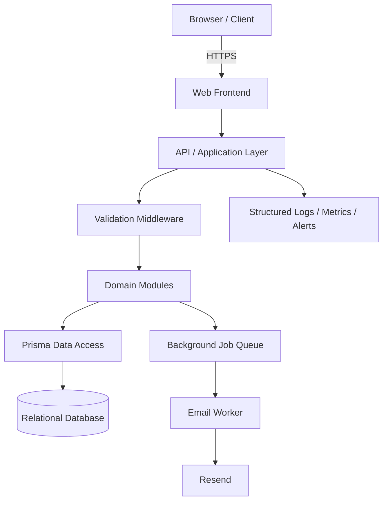

# Proposed Logical Architecture

Recommended design only; not a verified diagram of Cynbit production.

## Request lifecycle
1. Receive HTTPS request.
2. Apply body-size limit, security headers and rate limit.
3. Validate and normalize input.
4. Execute business logic.
5. Persist data.
6. Return a minimal consistent response.
7. Enqueue external side effects such as email delivery.
8. Record structured, redacted telemetry.
